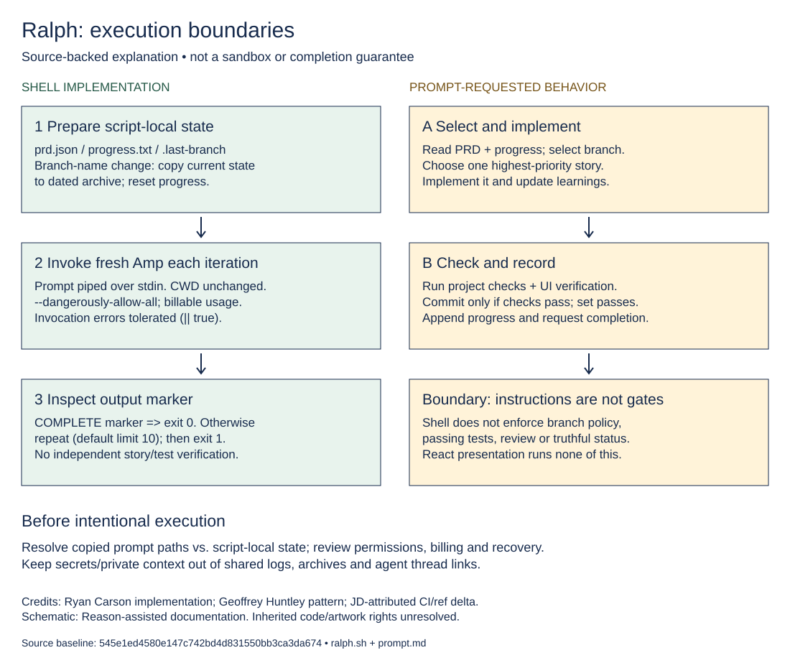

# Ralph — attributed derivative and contribution record

Ralph is a Bash wrapper that repeatedly invokes [Amp](https://ampcode.com) with a coding prompt. This repository also contains a separate React Flow presentation of the intended workflow. **The visualization does not run the agent.**

## Origins and JD's contribution

This is an inherited implementation with a small, focused maintenance delta, not a claim that JD created Ralph. The inspected history attributes the original wrapper, prompt, skills, visualization and Pages workflow to **Ryan Carson**. The approach credits **[Geoffrey Huntley's Ralph pattern](https://ghuntley.com/ralph/)**. See [Ryan Carson's article](https://x.com/ryancarson/status/2008548371712135632) and the [upstream reference repository](https://github.com/snarktank/ralph). A repository namespace is not authorship or a license grant.

At the audited base [`545e1ed`](https://github.com/JDKristenson/ralph/commit/545e1ed4580e147c742bd4d831550bb3ca3da674), the recorded JD-attributed contribution is:

- [Add ESLint and TypeScript/build CI](https://github.com/JDKristenson/ralph/commit/bde35b62e4990a84a19c62ae8f329480d3f12163).
- [Temporarily make lint non-blocking](https://github.com/JDKristenson/ralph/commit/8b98407cc2c90cadaa868021658fb5e9988886f6), then [pass static initial positions into `getNodes`](https://github.com/JDKristenson/ralph/commit/fbd867b1d11da939a77725a5cab34e0dad496227) instead of reading the mutable ref during initial rendering.
- [Restore blocking lint](https://github.com/JDKristenson/ralph/commit/545e1ed4580e147c742bd4d831550bb3ca3da674).

That net delta touches the CI workflow and a narrow React correction. Commit metadata supports attribution, not verified human-only authorship. No explicit AI contribution declarations were found in those commit messages; absence of a declaration does not prove absence of assistance. Amp is an execution dependency, not evidence that it authored every file. Upstream acceptance of JD's changes has not been established.

## Start here: visualization only

Use this path to inspect the presentation without Amp, credentials or agent permissions. See the [source-backed flowchart setup](flowchart/README.md) for commands and limitations. It uses React 19, TypeScript, Vite 7 and React Flow; the lockfile requires Node **20.19+ on the 20.x line, or 22.12+**. No test script is defined.

[Download/edit the Excalidraw source](docs/ralph-boundaries.excalidraw) · [Diagram notes and attribution](docs/README.md). The original [presentation screenshot](ralph-flowchart.png) and [artwork](ralph.webp) remain preserved. The [upstream interactive demo](https://snarktank.github.io/ralph/) is not a verified deployment of this repository.

## Agent runner: separate, privileged and potentially billable

**Do not run this merely to preview the project.** The wrapper invokes `amp --dangerously-allow-all`, requests code changes and commits, and can consume paid model/service usage. An iteration limit is not a spending cap or a safety sandbox. Review the current [Amp documentation](https://ampcode.com/manual), permissions and account billing before deliberately opting in. Keep secrets, private data and production access out of the target workspace unless explicitly required and authorized.

### Inferred setup (not an execution guarantee)

Prerequisites: Bash, Git, `jq`, ordinary Unix utilities and a separately installed/configured Amp CLI. The visualization does not need Amp. No credential check or Amp execution was performed for these docs.

For an intentionally selected target Git project, copy `ralph.sh` and `prompt.md` into `scripts/ralph/`, make the shell file executable, and create `scripts/ralph/prd.json` using [the example schema](prd.json.example). Review the prompt and all stories before execution. Do not treat the example as a production requirements file.

**Working directory matters:** run from the target project's root. The shell resolves state paths relative to its own location but never changes the process working directory. Amp receives the prompt over stdin, without a prompt-file path. The prompt's relative `prd.json`/`progress.txt` references therefore need explicit adjustment to `scripts/ralph/prd.json` and `scripts/ralph/progress.txt` in the copied prompt (including update instructions); otherwise the shell and agent may use different state files. This repository does not repair that ambiguity at runtime.

After that review and explicit opt-in, the inherited invocation is `./scripts/ralph/ralph.sh [max_iterations]` (default 10). This is documentation, not a recommendation to run unattended. The [PRD skill](skills/prd/SKILL.md) describes requirements drafting and the [Ralph skill](skills/ralph/SKILL.md) describes conversion to JSON. They are inherited instructions, not guaranteed installed tools. No global configuration change or experimental auto-handoff setting is required by this wrapper.

### What the shell enforces vs. what the prompt requests

**Implemented in [`ralph.sh`](ralph.sh):** resolve script-local state; initialize progress; track `branchName`; conditionally copy state to an archive and reset progress when the tracked branch name changes; invoke a fresh Amp process each iteration; stop with exit 0 if output contains `<promise>COMPLETE</promise>`; otherwise continue with a two-second delay and exit 1 after the iteration limit. The invocation tolerates failures with `|| true` and does not independently validate story completion. Other shell failures may terminate earlier under `set -e`.

**Requested in [`prompt.md`](prompt.md), not independently enforced by the wrapper:** check out/create the PRD branch; select one highest-priority incomplete story; implement it; run project quality checks; commit only after passing; update `passes`; append learnings; update relevant `AGENTS.md`; and perform browser verification for frontend work. Availability of the referenced browser skill is environment-dependent. The shell does not parse all story statuses before accepting the completion marker, validate test results, or enforce commit/review policy.

### State, privacy and recovery

- `prd.json`, `progress.txt`, `.last-branch` and `archive/` live beside the shell file. Git history and these files provide cross-iteration state; the prompt is supplied anew each time.
- On a tracked branch-name change, the shell copies the **currently present** PRD/progress files into a dated folder named from the previous branch, then resets progress. This is not a complete historical snapshot or transactional backup; repeated names/dates can reuse a folder.
- The inherited prompt requests an Amp thread link in progress logs. Logs, requirements, git history and archives can contain sensitive project context. Review them before sharing or committing; do not publish credentials, private endpoints or personal data. The wrapper prints agent output to the terminal.
- Retain a recoverable Git baseline and inspect changes manually. Completion output is an agent assertion, not independent verification or a security certification.

## Validation and deployment status

At base `545e1ed`, the recorded [CI run passed](https://github.com/JDKristenson/ralph/actions/runs/23726051812); the separate [Pages run failed](https://github.com/JDKristenson/ralph/actions/runs/23726051818). These are pinned historical run results, not guarantees about a later head or a live site. See [the flowchart README](flowchart/README.md) for local validation commands. The existing Pages workflow is retained unchanged; these docs do not enable Pages, change visibility or certify a deployment.

## License and reuse status

See [LICENSE-STATUS.md](LICENSE-STATUS.md). No repository-wide license grant was found at the audited base. Inherited code, text and artwork require provenance/license clarification; no blanket MIT grant is added. Preserve existing human/community attribution and any applicable third-party notices. Public availability alone is not permission to redistribute or relicense.
