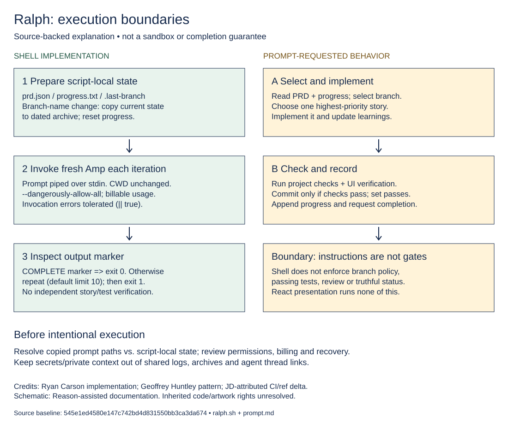

# Editable workflow boundaries

**[Editable Excalidraw scene](ralph-boundaries.excalidraw)** · [SVG preview](ralph-boundaries.svg)

Download the `.excalidraw` file using GitHub's raw/download control, then open/import it in Excalidraw (or a compatible local editor). Text, rectangles and arrows are separate editable elements, not a flattened screenshot. No service account or agent execution is needed. Import/edit behavior has not been tested in the Excalidraw application; JSON structure and the matching preview are checked separately.

## What this explains

The left lane describes operations implemented by `ralph.sh`. The right lane describes behavior requested in `prompt.md`, not independently enforced gates. The distinction includes completion-marker trust, tolerated invocation errors, unchanged working directory, state/privacy concerns, broad Amp permissions and possible usage costs. It is an explanation, not a runtime trace or security assurance.

Source baseline: [`545e1ed4580e147c742bd4d831550bb3ca3da674`](https://github.com/JDKristenson/ralph/commit/545e1ed4580e147c742bd4d831550bb3ca3da674), specifically [ralph.sh](https://github.com/JDKristenson/ralph/blob/545e1ed4580e147c742bd4d831550bb3ca3da674/ralph.sh) and [prompt.md](https://github.com/JDKristenson/ralph/blob/545e1ed4580e147c742bd4d831550bb3ca3da674/prompt.md). Runtime source is unchanged by this documentation cleanup.

## Editing and regeneration

For direct visual editing, treat the Excalidraw file as the editable source and re-export an SVG after changes. Alternatively, `generate-diagram.py` is a Python-standard-library generator for both checked-in artifacts: run `python docs/generate-diagram.py` from the repository root after editing its text/layout. Regeneration overwrites both files, so do not run it over unincorporated visual edits. No package installation, network request, project script or Amp invocation is part of this generator.

## Attribution and limits

Ryan Carson is credited for the inherited implementation, Geoffrey Huntley for the pattern, and JD for the recorded CI/ref correction delta (see the [contribution links](../README.md#origins-and-jds-contribution)). This new explanatory schematic was prepared with Reason assistance. It does not reuse the original character artwork and does not replace or remove it. The diagram does not imply original authorship of the project, upstream acceptance or rights clearance; see [license status](../LICENSE-STATUS.md).
